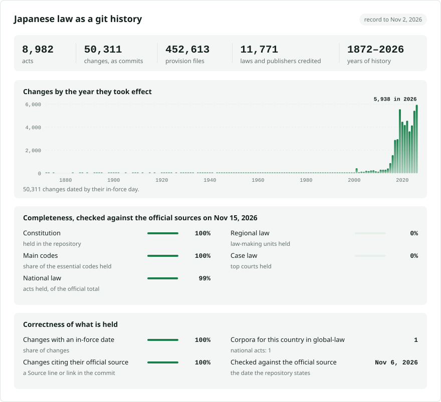

# Japan: law history in git

[日本語](README.md) · **English**

<picture>
<source media="(prefers-color-scheme: dark)" srcset="data/effort-dark.svg">

</picture>

The law of Japan as a git history: one file per article, one commit per version on the day it took effect, and the law that made each change as the commit's author. `git blame` names the law behind every paragraph; `git log` lists every change to an article; picking a date gives the text in force that day.

Part of [lexifina/global-law](https://github.com/lexifina/global-law), one git history for every country's law: this is Japan's national law, which global-law reads at `japan/national/acts/`.

**What is in it now:** the Constitution and 8,981 laws and regulations in force from e-Gov 法令検索: 2,078 Acts (法律), 2,320 Cabinet Orders (政令), 69 Imperial Ordinances (勅令), 4,085 Ministerial Ordinances (府省令), 406 Rules (規則), 13 Prime Minister decisions, 9 Dajōkan proclamations and notices and 1 regulation. 5,440 of them carry the revisions e-Gov holds, the rest so far only the text in force: 48,672 versions in all. 1,182 versions promulgated but not yet in force are on the branch `mishiko` (未施行), apart from `main`. [`ACTS.md`](ACTS.md) lists every law with its folder and versions; [`laws.csv`](laws.csv) every version with the law that made it and its dates.

Each law is a folder by kind, the Western year of its number and the number, `<kind>/<year>/<number>/` (ministerial ordinances and rules under their issuer): `act/1947/049/` is the 労働基準法, the Labour Standards Act, 昭和二十二年法律第四十九号; the Constitution is [`constitution/1946/`](constitution/1946/). Each article is one file (`art-039.md` is 第三十九条, `art-016-2.md` 第十六条の二), each paragraph one line; supplementary provisions (附則) are in `suppl/`, appended tables (別表) in `appdx/`. Before 2026-11-10 the folders were named by e-Gov law ID (`322AC0000000049/`) or a short name (`minpo/`): [`data/paths.json`](data/paths.json) maps the old names, and `git log --follow` and `git blame` follow them.

The text is in Japanese, as e-Gov publishes it, with ruby readings left out. An English translation is not part of this record.

## Questions as git commands

| Question | Command |
| --- | --- |
| Every change to Article 39 (annual paid leave) of the Labour Standards Act | `git log --follow -p --word-diff -- act/1947/049/art-039.md` |
| Which law wrote each line of Article 39? | `git blame act/1947/049/art-039.md` |
| Every version of the Labour Standards Act, with the day each took effect | `git log --invert-grep --grep="^Kind: documentation" --format="%h %(trailers:key=In-force,valueonly,separator=) %an" -- act/1947/049 322AC0000000049` |
| Article 39 as in force on 1 January 2018 | `python tools/jiten.py 2018-01-01 act/1947/049 39` |

**Outside git**, we also host this record publicly, for free:

- **[Ask Claude about Japanese law](https://global-law.lexifina.com/v1/try_claude?country=japan)**: opens Claude with a first question ready.
- **[Ask ChatGPT](https://global-law.lexifina.com/v1/try_chatgpt?country=japan)**: the same question in ChatGPT.
- **[Search Japanese law on our site](https://lexifina.com/law?country=japan&q=%E5%B9%B4%E6%AC%A1%E6%9C%89%E7%B5%A6%E4%BC%91%E6%9A%87)**: a search for "年次有給休暇" (annual paid leave), with each provision's text and its versions, no account needed.
- **[Developer REST API](https://global-law.lexifina.com/v1/search_law?query=%E5%B9%B4%E6%AC%A1%E6%9C%89%E7%B5%A6%E4%BC%91%E6%9A%87&jurisdiction=japan)**: the same search as JSON, with no key. See the [documentation here](https://lexifina.com/api/global-law).

Both assistants read the record through the free Global law connector (MCP, `https://global-law.lexifina.com/mcp`); the first time, the chat gives you the link that adds it. Ask in Japanese or in English.

**Host it yourself easily.** All it takes is git and Python, and the tools run on your machine:

```sh
git clone --depth 1 https://github.com/lexifina/global-law && cd global-law
python3 tools/countries.py add japan/national/acts
python3 tools/law.py show 2026-01-01 japan/national/acts/act/1947/049/art-039.md
```

Opened in Claude Code, Cursor, VS Code or Codex, the clone also starts a local MCP server with the same tools ([MCP.md](https://github.com/lexifina/global-law/blob/main/MCP.md)).

## Dates

Each commit is dated at noon, Asia/Tokyo, on the day the version took effect (施行日), as e-Gov gives it for each revision, and carries it in its `In-force:` trailer, with the day of promulgation in `Promulgated:`:

- a law that takes effect in stages (段階施行) has one commit per stage, each with a `Stage:` trailer;
- most laws were published first as their text in force (`Label: oldest version available`), and their earlier versions were then appended after it as correction commits, oldest first (`Kind: correction`, with the days each covers in `Corrects:`), ending with one that restores the text in force. So `git log` on such a law is not in date order: ask for a day with `tools/jiten.py`, which picks the version by `In-force:`, not with `git log --before`;
- git cannot store dates before 1970, so the 322 earlier commits are dated from 1970-01-01, one second apart, with the real day in `In-force:`;
- on `mishiko`, where a day is not yet fixed (政令で定める日), the latest day the law allows is used, and a `Date-note:` trailer says so.

Each change is credited to the law that made it, as e-Gov's revision record names it (`平成三十年法律第七十一号 (Act No. 71 of 2018)`), at an address that cannot exist (`430AC0000000071@e-gov.invalid`). The first text e-Gov holds of a law amended before its record begins, every text in force published alone, and the commits restoring it are credited to the publisher, `e-Gov 法令検索 (デジタル庁)`; the committer is always Lexifina.

## How it is checked

- Every version is read back from git on the day it took effect, as `tools/jiten.py` reads it, and compared with e-Gov's XML: file by file with the parsed text, and word for word with every text node of the XML, read without the parser.
- e-Gov's bulk download and its Law API serve the same XML (identical after canonicalisation for every revision compared); [`data/revisions.json`](data/revisions.json) gives each text's source and sha256.
- `tools/test_repo.py` checks that `git blame` names amending laws, that `tools/jiten.py` gives the text before and after a known amendment, that every commit's trailers parse, and that `mishiko` holds only changes not yet in force. The results are in [`REPRODUCE.md`](REPRODUCE.md).
- History is append-only: each append keeps the previous `main` and `mishiko` as ancestors and every tag where it was.
- [vulnerabilities/](vulnerabilities/README.en.md): possible drafting mistakes in Japanese law, found by global-law's detectors and checked by hand.

## What it does not show

- **Versions before e-Gov's record.** For most laws it starts in 2015, 2016 or 2017; the first text it holds includes every earlier amendment and is credited to e-Gov.
- **The earlier versions of 3,541 laws.** They hold only the text in force so far; the earlier versions e-Gov holds are added after them as correction commits.
- **Which law made the latest change** of a law whose history was appended: the commit restoring its text in force is credited to e-Gov, and only its `Revision:` trailer names the law (by e-Gov ID).
- **Repealed laws.** Only laws in force or promulgated are here.
- **The amending laws' own words (改め文)**, and how transitional provisions (経過措置, in `suppl/`) apply to past facts.
- **Forms and figures printed as images** (様式), case law and local ordinances (条例).

## Sources

| Source | Kind | Past versions | Notes |
| --- | --- | --- | --- |
| [e-Gov 法令検索](https://laws.e-gov.go.jp) (デジタル庁, Digital Agency) | Official law database: XML bulk download (text in force and not yet in force) and Law API Version 2 (each law's revisions and their texts) | yes, the revisions e-Gov holds | For reference: the authoritative text of a law is the one promulgated in the Official Gazette (官報) |

## Licence

See [`LICENSE`](LICENSE). Laws and regulations are not protected by copyright in Japan (著作権法 第十三条第一号); the text is from e-Gov 法令検索 under the Public Data License 1.0 (PDL1.0), split into files and arranged as a history by Lexifina. The history, commit messages, tables and tools are CC0 1.0.

No AI model wrote or changed legal text, and none is called when the history is built or checked; an AI model wrote the code and the documentation (see [`REPRODUCE.md`](REPRODUCE.md)).

## Visualisations

[visualisations/](visualisations/): Japanese law in 20 charts, drawn from this repository.

Including:

- The kinds and eras of the laws in force, laws still in the katakana style, and branch-numbered articles
- The history of amendment kept in supplementary provisions, omnibus Acts, and how Acts set their start
- Cabinet and members' bills, the ministries behind the ordinances, and the Constitution and the codes article by article

## More

From [lexifina/global-law](https://github.com/lexifina/global-law):

- [FEATURES.md](https://github.com/lexifina/global-law/blob/main/FEATURES.md): every feature, and what every corpus must support (`git blame`, `law.py`, the MCP tools)
- [FAQ.md](https://github.com/lexifina/global-law/blob/main/FAQ.md): questions and answers · [CONTRIBUTING.md](https://github.com/lexifina/global-law/blob/main/CONTRIBUTING.md): proposing changes · [MCP.md](https://github.com/lexifina/global-law/blob/main/MCP.md): the MCP server · [REPRODUCE.md](https://github.com/lexifina/global-law/blob/main/REPRODUCE.md): how it was built · [CHANGELOG.md](https://github.com/lexifina/global-law/blob/main/CHANGELOG.md)
- [FRESHNESS.md](https://github.com/lexifina/global-law/blob/main/FRESHNESS.md): how current each corpus is · [Monitoring](https://github.com/lexifina/global-law/tree/main/monitoring): whether updates are running · [WATCHING.md](https://github.com/lexifina/global-law/blob/main/WATCHING.md): how each official source is watched for changes
- [performance/](https://github.com/lexifina/global-law/tree/main/performance): how fast the tools are, measured
- [visualisations/](https://github.com/lexifina/global-law/tree/main/visualisations): charts and bridges across the world's law
- [Vulnerabilities](https://github.com/lexifina/global-law/tree/main/vulnerabilities): mistakes in legislation as published
