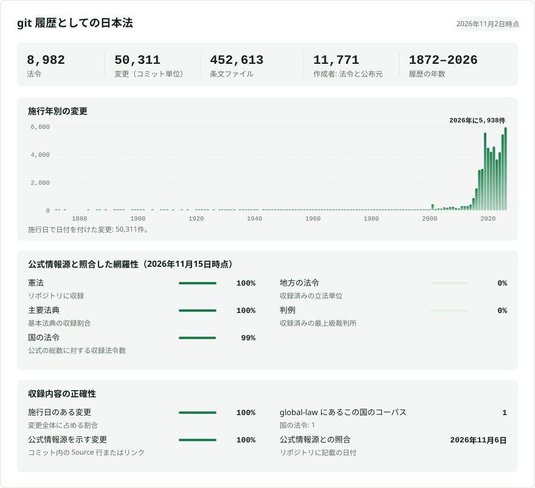

# 日本：git による法令の履歴

**日本語** · [English](README.en.md)

<picture>
<source media="(prefers-color-scheme: dark)" srcset="data/ja/effort-dark.svg">

</picture>

日本の法令を git の履歴にしたものです。条ごとに一つのファイル、版ごとに施行日付の一つのコミットとし、その変更を行った法令をコミットの作成者（author）としています。`git blame` はすべての項についてそれを書いた法令を示し、`git log` は条ごとのすべての変更を一覧にし、日付を選べばその日に施行されていた本文が得られます。

[lexifina/global-law](https://github.com/lexifina/global-law)（すべての国の法令を一つの git 履歴にまとめたもの）の一部です。これは日本の国の法令で、global-law は `japan/national/acts/` で読み込みます。

**現在の収録内容：** e-Gov 法令検索の現行の憲法と法令 8,981 件：法律 2,078 件、政令 2,320 件、勅令 69 件、府省令 4,085 件、規則 406 件、内閣総理大臣決定 13 件、太政官布告・達 9 件、規程 1 件。うち 5,440 件は e-Gov が保有する改正履歴つきで、残りは現時点では現行の本文のみです。版の総数は 48,672 です。公布済みで未施行の 1,182 版は `main` とは別のブランチ `mishiko`（未施行）にあります。[`ACTS.md`](ACTS.md) はすべての法令をそのフォルダと版とともに、[`laws.csv`](laws.csv) はすべての版をそれを定めた法令と日付とともに一覧にしています。

各法令は種別、法令番号の西暦年、番号によるフォルダ `<kind>/<year>/<number>/` にあります（府省令と規則は制定機関ごと）。`act/1947/049/` は労働基準法（昭和二十二年法律第四十九号）で、憲法は [`constitution/1946/`](constitution/1946/) です。各条が一つのファイル（`art-039.md` は第三十九条、`art-016-2.md` は第十六条の二）、各項が一行です。附則は `suppl/`、別表は `appdx/` にあります。2026年11月10日より前は、フォルダ名は e-Gov の法令 ID（`322AC0000000049/`）または略称（`minpo/`）でした。[`data/paths.json`](data/paths.json) が旧名との対応を示し、`git log --follow` と `git blame` は旧名をたどります。

本文は e-Gov が公開しているとおりの日本語で、ルビは省いています。英訳はこの記録に含まれません。

## git コマンドで答える問い

| 問い | コマンド |
| --- | --- |
| 労働基準法第三十九条（年次有給休暇）のすべての変更 | `git log --follow -p --word-diff -- act/1947/049/art-039.md` |
| 第三十九条の各行はどの法令が書いたか | `git blame act/1947/049/art-039.md` |
| 労働基準法のすべての版と、それぞれの施行日 | `git log --invert-grep --grep="^Kind: documentation" --format="%h %(trailers:key=In-force,valueonly,separator=) %an" -- act/1947/049 322AC0000000049` |
| 2018年1月1日時点の第三十九条 | `python tools/jiten.py 2018-01-01 act/1947/049 39` |

**git の外でも**、この記録を無料で公開しています。

- **[日本法について Claude に聞く](https://global-law.lexifina.com/v1/try_claude?country=japan)**：最初の質問を用意した状態で Claude を開きます。
- **[ChatGPT に聞く](https://global-law.lexifina.com/v1/try_chatgpt?country=japan)**：同じ質問を ChatGPT で。
- **[当サイトで日本法を検索](https://lexifina.com/law?country=japan&q=%E5%B9%B4%E6%AC%A1%E6%9C%89%E7%B5%A6%E4%BC%91%E6%9A%87)**：「年次有給休暇」の検索結果を、各条文の本文とその版とともに表示します。アカウントは不要です。
- **[開発者向け REST API](https://global-law.lexifina.com/v1/search_law?query=%E5%B9%B4%E6%AC%A1%E6%9C%89%E7%B5%A6%E4%BC%91%E6%9A%87&jurisdiction=japan)**：同じ検索を JSON で。キーは不要です。[ドキュメントはこちら](https://lexifina.com/api/global-law)。

どちらのアシスタントも、無料の Global law コネクタ（MCP、`https://global-law.lexifina.com/mcp`）を通じてこの記録を読みます。初回はチャットにコネクタを追加するリンクが表示されます。質問は日本語でも英語でもかまいません。

**自分で簡単にホストできます。** 必要なのは git と Python だけで、ツールは手元のマシンで動きます。

```sh
git clone --depth 1 https://github.com/lexifina/global-law && cd global-law
python3 tools/countries.py add japan/national/acts
python3 tools/law.py show 2026-01-01 japan/national/acts/act/1947/049/art-039.md
```

Claude Code、Cursor、VS Code または Codex で開くと、このクローンは同じツールを備えたローカルの MCP サーバーも起動します（[MCP.md](https://github.com/lexifina/global-law/blob/main/MCP.md)）。

## 日付

各コミットは、その版が施行された日（施行日）の正午（Asia/Tokyo）の日付で、日付は e-Gov が改正ごとに示すものです。施行日は `In-force:` トレーラーに、公布日は `Promulgated:` に記録しています。

- 段階的に施行される法令（段階施行）は段階ごとに一つのコミットとし、それぞれに `Stage:` トレーラーを付けています。
- 多くの法令は、まず現行の本文として公開し（`Label: oldest version available`）、その後に過去の版を訂正コミットとして古い順に追加し（`Kind: correction`、対象となる日は `Corrects:`）、最後に現行の本文を戻すコミットで終えています。そのため、そのような法令では `git log` は日付順になりません。ある日の本文は `git log --before` ではなく、`In-force:` によって版を選ぶ `tools/jiten.py` で求めてください。
- git は1970年より前の日付を保存できないため、それ以前の 322 件のコミットは1970年1月1日から1秒ずつずらした日付とし、実際の日は `In-force:` に記録しています。
- `mishiko` では、施行日がまだ定まっていない場合（政令で定める日）、法令が認める最も遅い日を用い、`Date-note:` トレーラーでその旨を示しています。

各変更は、e-Gov の改正履歴が示すとおり、それを行った法令（`平成三十年法律第七十一号 (Act No. 71 of 2018)`）の名義とし、存在し得ないアドレス（`430AC0000000071@e-gov.invalid`）を用いています。記録の開始前に改正された法令について e-Gov が保有する最初の本文、単独で公開したすべての現行の本文、およびそれを戻すコミットは、公開元である `e-Gov 法令検索 (デジタル庁)` の名義としています。コミッターは常に Lexifina です。

## 検証の方法

- すべての版を、施行された日の時点で `tools/jiten.py` と同じ方法で git から読み戻し、e-Gov の XML と照合しています。解析した本文とはファイルごとに、XML のすべてのテキストノードとは解析器を通さずに一語ずつ比較しています。
- e-Gov の一括ダウンロードと法令 API は同じ XML を提供しています（比較したすべての改正について、正規化後に同一）。[`data/revisions.json`](data/revisions.json) は各本文の出典と sha256 を示しています。
- `tools/test_repo.py` は、`git blame` が改正法令を示すこと、`tools/jiten.py` が既知の改正の前後の本文を返すこと、すべてのコミットのトレーラーが解析できること、`mishiko` が未施行の変更だけを含むことを確認しています。結果は [`REPRODUCE.md`](REPRODUCE.md) にあります。
- 履歴は追記のみです。追記のたびに、それまでの `main` と `mishiko` を祖先として残し、すべてのタグを元の位置に保ちます。
- [vulnerabilities/](vulnerabilities/)：global-law の検出器が見つけ、手で確かめた、日本の法令における立案上の誤りの可能性。

## 示していないもの

- **e-Gov の記録より前の版。** 多くの法令では2015年、2016年または2017年から始まります。e-Gov が保有する最初の本文はそれ以前のすべての改正を含んでおり、e-Gov の名義としています。
- **3,541 件の法令の過去の版。** 現時点では現行の本文のみで、e-Gov が保有する過去の版は、その後に訂正コミットとして追加します。
- 履歴を追加した法令について、**最新の変更を行った法令。** 現行の本文を戻すコミットは e-Gov の名義であり、その法令は `Revision:` トレーラーだけが（e-Gov の ID で）示しています。
- **廃止された法令。** 収録しているのは現行の法令と公布済みの法令だけです。
- **改正法令自体の文言（改め文）**、および経過措置（`suppl/` にあります）が過去の事実にどう適用されるか。
- **画像として掲載された様式や図**、判例および地方公共団体の条例。

## 出典

| 出典 | 種類 | 過去の版 | 備考 |
| --- | --- | --- | --- |
| [e-Gov 法令検索](https://laws.e-gov.go.jp)（デジタル庁） | 公式の法令データベース：XML 一括ダウンロード（現行および未施行の本文）と法令 API Version 2（各法令の改正とその本文） | あり（e-Gov が保有する改正） | 参考用：法令の正式な本文は官報に公布されたものです |

## ライセンス

[`LICENSE`](LICENSE) をご覧ください。日本では法令は著作権の目的となりません（著作権法 第十三条第一号）。本文は e-Gov 法令検索のもので、公共データ利用規約（PDL1.0）に基づき、Lexifina がファイルに分割し履歴として編成しました。履歴、コミットメッセージ、表およびツールは CC0 1.0 です。

AI モデルが法令の本文を書いたり変更したりしたことはなく、履歴の構築や検証の際に AI モデルを呼び出すこともありません。コードとドキュメントは AI モデルが書きました（[`REPRODUCE.md`](REPRODUCE.md) を参照）。

本書は英語版（[README.en.md](README.en.md)）の翻訳です。両者が異なる場合は、英語版が優先します。

## 詳細情報

[lexifina/global-law](https://github.com/lexifina/global-law) リポジトリより（英語のページ）:

- [FEATURES.md](https://github.com/lexifina/global-law/blob/main/FEATURES.md): すべての機能と、各コーパスが対応すべき事項（`git blame`、`law.py`、MCP ツール）
- [FAQ.md](https://github.com/lexifina/global-law/blob/main/FAQ.md): よくある質問 · [CONTRIBUTING.md](https://github.com/lexifina/global-law/blob/main/CONTRIBUTING.md): 変更の提案 · [MCP.md](https://github.com/lexifina/global-law/blob/main/MCP.md): MCP サーバー · [REPRODUCE.md](https://github.com/lexifina/global-law/blob/main/REPRODUCE.md): 構築の方法 · [CHANGELOG.md](https://github.com/lexifina/global-law/blob/main/CHANGELOG.md)
- [FRESHNESS.md](https://github.com/lexifina/global-law/blob/main/FRESHNESS.md): 各コーパスがどこまで最新か · [監視](https://github.com/lexifina/global-law/tree/main/monitoring): 更新が正常に動いているか · [WATCHING.md](https://github.com/lexifina/global-law/blob/main/WATCHING.md): 各公式情報源の変更をどのように監視しているか
- [performance/](https://github.com/lexifina/global-law/tree/main/performance): ツールの速度の実測
- [visualisations/](https://github.com/lexifina/global-law/tree/main/visualisations): 世界中の法をまたぐグラフとつながり
- [脆弱性](https://github.com/lexifina/global-law/tree/main/vulnerabilities): 公布されたとおりの法令に含まれる誤り
