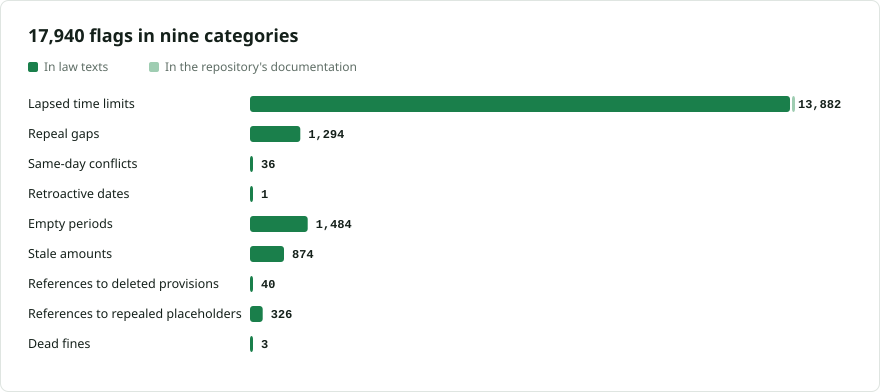

# Vulnerabilities in Japanese law

[日本語](README.md) · **English**

<picture>
<source media="(prefers-color-scheme: dark)" srcset="img/flags-by-category-dark.svg">

</picture>

The vulnerability detectors from [lexifina/global-law](https://github.com/lexifina/global-law/tree/main/vulnerabilities) look for mechanical mistakes in legislation: a rule applying "until" a date that has passed, a time limit extended only after it had run out, a provision removed before its replacement took effect, two amendments to the same provision on the same day, an amount changed in one place and left standing in another, a reference to an article that no longer exists. global-law's published list (9 November 2026) covered Japan with 32 flags, all same-day conflicts in the Act on the Protection of Personal Information, from an earlier copy of this repository; its detectors could not read Japanese dates. So this is a run over this repository only, as it stood at commit [`85525f9`](https://github.com/lexifina/japan-law/commit/85525f9094c85a1a357f545e847ab8cf7f24c52b) on 16 November 2026, with all 8,981 laws it holds and the earlier versions it holds for 5,440 of them, and with the detectors taught to read Japanese.

**In short:** the detectors raised 17,940 flags. A language model reviewed 358 of the strongest, arguing each one for and against; 126 survived. Checked by hand in this repository, two look like real drafting mistakes. A 1977 supplementary provision of the Order for Enforcement of the Immunization Act (予防接種法施行令) adjusts the death lump sum by rewriting "四千四百二十万円" in Article 17(4)(ii); the yearly orders of 2018 to 2020 changed that quotation each time they raised the sum, but since 1 April 2023 the article has read 45,300,000 yen (49,500,000 yen today) and the quotation still reads 44,200,000 yen. And Article 69 of the Ordinance for Enforcement of the National Pension Act (国民年金法施行規則) still suspends payment when "the documents under Article 51-5" are not submitted, an article that Ministerial Ordinance No. 30 of 2024 removed from 1 April 2024. Eight more are empty periods: a time limit ran out and the law that extended it took effect weeks, months or, once, two years later, with no retroactive words. Among them, the deadlines for proposals and applications under the Act on Special Zones for Structural Reform (構造改革特別区域法) lapsed twice (1 April to 22 June 2017 and 1 April to 31 May 2022), and transition plans of medical corporations could not be certified from 1 October 2020 to 27 May 2021. Of the other 116, 30 come from how this repository or its source dates and holds the texts, 2 are misreadings by a detector, 61 are lawful, 2 are spent rules, 14 are the same amount appearing by coincidence in another act, and 7 could not be settled from the record. Reading the categories the model does not review turned up one more leftover: Article 7 of an ordinance on greenhouse gas reporting still rewrites words in Article 3, which has read only "削除" (deleted) since 1 April 2022. Later, this will be formalised in Lean, similar to our work on [the US tax code](https://lexifina.com/blog/formalizing-the-us-tax-code) and [US case law](https://lexifina.com/blog/formalizing-all-us-case-law-in-lean).

A flag is a prompt to look, not legal advice, and nothing here has been tested in court.

## Flags by category

| Category | What it looks for | Flags | In law texts | Reviewed | Survived review |
| --- | --- | ---: | ---: | ---: | ---: |
| Lapsed time limits | Text still applying a rule "until" a date that has passed | 13,882 | 13,881 | 40 | 1 |
| Repeal gaps | A provision removed before its replacement took effect | 1,294 | 1,294 | 40 | 2 |
| Same-day conflicts | Two acts changing the same provision on the same day | 36 | 36 | 36 | 3 |
| Retroactive or pre-publication dates | A rule in force before it was promulgated | 1 | 1 | 1 | 0 |
| Empty periods | A time limit extended by an act that took effect after it had run out | 1,484 | 1,484 | 161 | 97 |
| Stale amounts | An amount changed in one place but still standing elsewhere | 874 | 874 | 40 | 16 |
| References to deleted provisions | A provision citing an article that no longer exists | 40 | 40 | 40 | 7 |
| References to repealed placeholders | A provision citing an article that now reads only "削除" (deleted) | 326 | 326 | 0 | 0 |
| Dead fines | A penalty for breaching an article that has been deleted | 3 | 3 | 0 | 0 |

"In law texts" counts the Constitution, acts, cabinet orders, imperial ordinances, ministerial ordinances, rules of commissions and agencies, Prime Minister decisions and Dajōkan proclamations and notices, with their supplementary provisions and appended tables. The one other flag is in this repository's list of acts (`ACTS.md`). Japanese law writes dates in era years and kanji numerals, with "until" after the date (令和二年三月三十一日まで, …までの間, …限り), and fiscal years (令和五年度まで, which ends on 31 March 2024); the searches for lapsed time limits and empty periods now read these, and treat "までに" (by) as a deadline. Amounts in yen are read in kanji numerals (五十万円). A reference such as 第十六条の二 is to Article 16-2; one in a list that begins with another act's name or number (地方自治法第二条、第十条…), in a quotation (「第十七条」とあるのは) or after 附則 is not to the act's own article. 11,129 of the lapsed time limits are in supplementary provisions, which keep transitional rules after they have run their course. An article deleted with its number kept reads "第十条　削除" here, so a reference to it counts as a reference to a repealed placeholder; an article struck out altogether leaves no file, so a reference to it counts as a reference to a deleted provision. The search for duplicate numbering, dead currencies and publisher notes found nothing.

*Edge cases: the 126 flags that survived the review, grouped by what they turned out to be, and what the other flags are, in [EDGE-CASES.en.md](EDGE-CASES.en.md).*

## Problems found in this repository

- **One version a day:** where e-Gov records several amendments taking effect on one day, this history keeps only the last of them, credited to that law, so the others' changes are credited to it too. On 1 April 2024 e-Gov lists six ordinances amending the National Pension Act ordinance; the version [credited](https://github.com/lexifina/japan-law/commit/3cd2a2a40068038c5d5d4f74b5b7b8b4a9dddaf9) to Ministerial Ordinance No. 62 of 2024 removes Article 51-5, which e-Gov's own versions show was removed by No. 30. For the same reason, the history shows two laws changing one provision on one day only in the eight acts it has kept with ordinary dated commits (36 flags, all in three of them).
- **Dates of the 2017 tax reform:** the Act on Special Measures Concerning Taxation (租税特別措置法) has its changes by Act No. 4 of 2017 from [1 May 2017](https://github.com/lexifina/japan-law/commit/d36bf6c33a829de8019884893bc88920fba2ea4d), the first of the twelve stages e-Gov lists for that act, although its supplementary provisions put the main part in force on 1 April 2017. Reliefs ending on 31 March 2017 therefore seem to lapse for a month (25 flags).
- **Articles missing from e-Gov's text:** from 11 December 2019 (the version credited to Act No. 71 of 2019) the Act on the Arrangement of Relevant Acts for the Companies Act (会社法の施行に伴う関係法律の整備等に関する法律, Act No. 87 of 2005) has no Articles 64 to 526, though its table of contents still lists them, and e-Gov's current text has none of them either. Articles 47, 52, 53 and 61 still cite Article 66 (the continuation of old stock companies).
- **`order.txt`:** 152 act folders hold a file `order.txt`, which lists the act's files in reading order and is not described in the README; 240 acts have one in some version of their history. Tools that read every text file read it as a provision (12 repeal gaps).
- **History out of date order:** earlier versions were appended after each act's current text as correction commits, and the folders were renamed on 10 November 2026; detectors that read history in commit order see every first earlier version as a reversal of every later change. This run puts each act's versions in date order first (see [tools/](tools/)).

## Files

| File | What it holds |
| --- | --- |
| [data/flags.csv](data/flags.csv) | Every flag, one row per provision and issue |
| [data/reviewed.csv](data/reviewed.csv) | The 358 flags the model reviewed, with its verdict and reason |
| [data/by_category.csv](data/by_category.csv) | The counts in the table above |
| [tools/](tools/) | The scripts that made this run |

Columns: `category` and `category_ja` (the category in English and Japanese), `detector`, `kind` (`law` or `other`), `path` (the file in this repository), `date` (the date the flag turns on), `reference` (the law or line involved), `summary`, `score` (the detector's ranking, 0 to 1), `review` (`artefact`, `lawful` or `candidate_defect`), `survives_rebuttal`, `review_note` (the model's reason, in English), `url` (the provision at the commit that was read, or, for one no longer in today's text, the last version of its act that held it; for a retroactive date, the commit credited to the law).

## How it was made

- **Detectors:** global-law's [vulnerabilities/scripts](https://github.com/lexifina/global-law/tree/main/vulnerabilities/scripts), run on this repository at commit `85525f9`. global-law replays this repository only up to an earlier commit, so the history table the detectors read was built from this repository's own commits, then put in date order: each act's versions are its earlier versions and its current text sorted by their `In-force` day, each compared with the one before, under the act's folder today; each is credited to the law its commit names (the current text, which the repository credits to e-Gov, to the law in its `Revision:` trailer). The detectors were taught Japanese dates, yen amounts, article numbers and the "削除" placeholder, and to read the `Promulgated:` trailer.
- **Model review:** gpt-5.4-mini, the 40 strongest flags per category, and for lapsed time limits also the 40 strongest in law texts; one pass says whether a flag is real, a second argues that it is not. Empty periods use global-law's own review for that category, on the 161 flags whose old and new date are in one sentence, followed by the same second pass. Categories with fewer flags were reviewed in full. The model does not review references to repealed placeholders or dead fines. global-law's own list used a different model.
- **Hand check:** every flag that survived was read in this repository's history and texts, with the amending law's supplementary provisions, which this repository keeps with each act they amend (it does not hold the amending laws' own text). For the two likely mistakes, the extensions credited to Ministerial Ordinance No. 30 of 2024 and the 2023 to 2026 orders, e-Gov's versions of each amendment were read as well. The amending acts as promulgated in the Official Gazette (官報) were not read. Of the categories the model does not review, the 3 dead fines and a sample of the references to placeholders were read.

To report a correction, open an issue with the provision and an official source.

## Licence

The lists and notes are Lexifina's, dedicated to the public domain under CC0 1.0, like the rest of this repository's own contributions. Quoted law text is as e-Gov 法令検索 (Digital Agency) publishes it; laws are not subject to copyright in Japan (Article 13 of the Copyright Act), and e-Gov's site content is under the Public Data License 1.0. See [LICENSE](../LICENSE).
