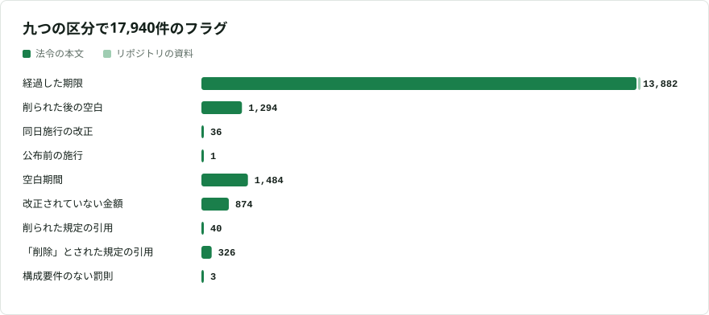

# 日本法の脆弱性

**日本語** · [English](README.en.md)

<picture>
<source media="(prefers-color-scheme: dark)" srcset="img/flags-by-category-dark.ja.svg">

</picture>

[lexifina/global-law](https://github.com/lexifina/global-law/tree/main/vulnerabilities) の脆弱性検出器は、法令の機械的な誤りを探します。すでに過ぎた日「まで」適用するとしている規定、期限が切れた後になって延長された期限、後継の規定が施行される前に削られた規定、同じ日に同じ規定を改める二つの改正、一か所だけ改められて他の箇所に残った金額、もう存在しない条の引用などです。global-law が2026年11月9日に公表した一覧は、このリポジトリの以前の版から、個人情報の保護に関する法律の同日施行の改正32件を日本について挙げていましたが、その検出器は日本語の日付を読めませんでした。そこで今回は、このリポジトリだけを対象に、2026年11月16日のコミット [`85525f9`](https://github.com/lexifina/japan-law/commit/85525f9094c85a1a357f545e847ab8cf7f24c52b) の時点で収録している8,981件の法令すべてと、そのうち5,440件の過去の版について、日本語を読めるようにした検出器を実行しました。

**要約：** 検出器は17,940件のフラグを立てました。言語モデルがそのうち特に強い358件を検討し、それぞれについて肯定と否定の両面から論じた結果、126件が残りました。このリポジトリで一件ずつ確かめたところ、二件は実際の立案上の誤りと考えられます。予防接種法施行令の昭和五十二年政令第十七号附則第二条は、第十七条第四項第二号中「四千四百二十万円」とあるのを読み替えて死亡一時金を調整していますが、平成三十年から令和二年までの毎年の改正政令はこの金額を引き上げるたびに読替えの文言も改めていたのに対し、令和五年四月一日以降、同号の額は四千五百三十万円（現在は四千九百五十万円）となり、読替えの文言は四千四百二十万円のままです。また、国民年金法施行規則第六十九条は、なお「第五十一条の五に規定する書類」を提出しないときに支払を一時差し止めるとしていますが、第五十一条の五は令和六年厚生労働省令第三十号により令和六年四月一日から削られています。さらに八件は空白期間です。期限が切れた後、それを延長する法令が数週間、数か月、一件では二年後に施行され、遡って適用する定めもありません。その中には、二度切れた構造改革特別区域法の提案の募集と計画の認定申請の期限（2017年4月1日から6月22日まで、2022年4月1日から5月31日まで）や、医療法人の移行計画の認定が行えなかった2020年10月1日から2021年5月27日までの期間があります。残る116件のうち、30件はこのリポジトリまたはその公開元による日付や本文の持ち方に起因し、2件は検出器の読み誤り、61件は適法、2件は役目を終えた規定、14件は別の法令に偶然同じ金額があるもの、7件は記録からは判断できないものです。モデルが検討しない区分を読んだところ、もう一件の取り残しが見つかりました。温室効果ガス算定排出量等の集計の方法等を定める省令第七条は、令和四年四月一日以降「削除」とだけある第三条の字句を今も読み替えています。今後、これを Lean で形式化する予定です。[米国の税法](https://lexifina.com/blog/formalizing-the-us-tax-code)や[米国の判例法](https://lexifina.com/blog/formalizing-all-us-case-law-in-lean)についての取組と同様です。

フラグは確認のきっかけであって法的助言ではなく、ここに示したものはいずれも裁判で確かめられたものではありません。

## 区分ごとのフラグ

| 区分 | 探すもの | フラグ | 法令の本文 | 検討済み | 検討後に残ったもの |
| --- | --- | ---: | ---: | ---: | ---: |
| 経過した期限 | すでに過ぎた日「まで」規定を適用するとしている本文 | 13,882 | 13,881 | 40 | 1 |
| 削られた後の空白 | 後継の規定が施行される前に削られた規定 | 1,294 | 1,294 | 40 | 2 |
| 同日施行の改正 | 同じ日に同じ規定を改める二つの法令 | 36 | 36 | 36 | 3 |
| 公布前の施行 | 公布より前に施行されたことになっている規定 | 1 | 1 | 1 | 0 |
| 空白期間 | 期限が切れた後に施行された法令による期限の延長 | 1,484 | 1,484 | 161 | 97 |
| 改正されていない金額 | 一か所で改められ、他の箇所に残っている金額 | 874 | 874 | 40 | 16 |
| 削られた規定の引用 | もう存在しない条を引用している規定 | 40 | 40 | 40 | 7 |
| 「削除」とされた規定の引用 | 「削除」とだけある条を引用している規定 | 326 | 326 | 0 | 0 |
| 構成要件のない罰則 | 削られた条の違反を罰する規定 | 3 | 3 | 0 | 0 |

「法令の本文」には、憲法、法律、政令、勅令、府省令、委員会等の規則、内閣総理大臣決定、太政官布告・達を、その附則と別表を含めて数えています。それ以外の一件は、このリポジトリの法令一覧（`ACTS.md`）にあります。日本の法令は日付を元号と漢数字で書き、「まで」を日付の後に置き（令和二年三月三十一日まで、…までの間、…限り）、年度でも書く（令和五年度まで、すなわち2024年3月31日まで）ため、期限と空白期間の検索はこれらを読むようにし、「までに」は履行の期限として扱います。金額は漢数字の円（五十万円）を読みます。第十六条の二は第十六条ではなく第十六条の二を指すものとし、他の法令の名称や番号から始まる列挙（地方自治法第二条、第十条…）、引用符の中（「第十七条」とあるのは）、附則の後に置かれた条は、その法令自身の条とはしません。経過した期限のうち11,129件は附則にあり、附則は役目を終えた経過規定や時限的な規定をそのまま残しています。番号を残して削除された条はこのリポジトリでは「第十条　削除」とあるため、その引用は「削除」とされた規定の引用に数え、全体が削られた条はファイルが残らないため、その引用は削られた規定の引用に数えます。番号の重複、廃止された通貨、公開元の注記の検索では何も見つかりませんでした。

*境界事例：検討後に残った126件を、実際に何であったかによって分類したもの、およびその他のフラグについては [EDGE-CASES.md](EDGE-CASES.md) をご覧ください。*

## このリポジトリで見つかった問題

- **一日に一つの版：** e-Gov が同じ日に施行される複数の改正を記録している場合、この履歴はその日の最後の改正だけを残し、その法令の名義にしているため、他の改正による変更もその法令のものとなります。e-Gov は2024年4月1日に国民年金法施行規則を改める省令を六件挙げていますが、令和六年厚生労働省令第六十二号の名義の[版](https://github.com/lexifina/japan-law/commit/3cd2a2a40068038c5d5d4f74b5b7b8b4a9dddaf9)が第五十一条の五を削っており、e-Gov の各版によれば、これを削ったのは第三十号です。同じ理由で、二つの法令が同じ日に同じ規定を改めた形が履歴に現れるのは、通常の日付順のコミットで保持している八つの法令だけです（36件、すべてそのうちの三法令）。
- **平成二十九年度税制改正の日付：** 租税特別措置法について、平成二十九年法律第四号による改正は[2017年5月1日](https://github.com/lexifina/japan-law/commit/d36bf6c33a829de8019884893bc88920fba2ea4d)の版にあります。これはこの履歴がこの法律について示す十二の段階の最初ですが、同法附則は本体部分を2017年4月1日から施行するとしています。このため、2017年3月31日までの特例が一か月切れたように見えます（25件）。
- **e-Gov の本文にない条：** 会社法の施行に伴う関係法律の整備等に関する法律（平成十七年法律第八十七号）は、2019年12月11日（令和元年法律第七十一号の名義の版）以降、第六十四条から第五百二十六条までを欠いていますが、目次にはなお掲げられており、e-Gov の現行の本文にもこれらの条はありません。第四十七条、第五十二条、第五十三条及び第六十一条は、今も第六十六条（旧株式会社の存続）を引用しています。
- **`order.txt`：** 152の法令のフォルダに、その法令のファイルを読む順に並べた `order.txt` というファイルがありますが、README には説明がありません。240の法令では、履歴のいずれかの版にこのファイルがあります。すべてのテキストファイルを読むツールは、これを規定として読みます（削られた後の空白12件）。
- **日付順でない履歴：** 過去の版は各法令の現行の本文の後に訂正コミットとして追加され、フォルダ名は2026年11月10日に変更されています。履歴をコミット順に読む検出器には、最初の過去の版がそれ以降のすべての改正を取り消したように見えます。今回の実行では、まず各法令の版を日付順に並べ直しました（[tools/](tools/) を参照）。

## ファイル

| ファイル | 内容 |
| --- | --- |
| [data/flags.csv](data/flags.csv) | すべてのフラグ。規定と問題ごとに一行 |
| [data/reviewed.csv](data/reviewed.csv) | モデルが検討した358件のフラグと、その判断及び理由 |
| [data/by_category.csv](data/by_category.csv) | 上の表の件数 |
| [tools/](tools/) | 今回の実行に用いたスクリプト |

列：`category` と `category_ja`（区分の英語名と日本語名）、`detector`、`kind`（`law` または `other`）、`path`（このリポジトリのファイル）、`date`（フラグの基準となる日）、`reference`（関係する法令または行）、`summary`、`score`（検出器による順位付け、0から1）、`review`（`artefact`、`lawful` または `candidate_defect`）、`survives_rebuttal`、`review_note`（モデルの理由、英語）、`url`（読み取ったコミットにおける規定。現行の本文にない規定は、それを含んでいた法令の最後の版。公布前の施行は、その法令の名義のコミット）。

## 作成の方法

- **検出器：** global-law の [vulnerabilities/scripts](https://github.com/lexifina/global-law/tree/main/vulnerabilities/scripts) を、このリポジトリのコミット `85525f9` に対して実行しました。global-law はこのリポジトリを以前のコミットまでしか取り込んでいないため、検出器が読む履歴の表はこのリポジトリ自身のコミットから作成し、日付順に並べ直しました。各法令の版（過去の版と現行の本文）を `In-force` の日で並べ、一つ前の版と比べ、現在のフォルダの下に置き、コミットが示す法令の名義としました（このリポジトリが e-Gov の名義としている現行の本文は、`Revision:` トレーラーが示す法令の名義）。検出器には、日本語の日付、円の金額、条の番号、「削除」の規定を読むこと、及び `Promulgated:` トレーラーを読むことを加えました。
- **モデルによる検討：** gpt-5.4-mini により、区分ごとに最も強い40件、経過した期限については法令の本文で最も強い40件も検討しました。最初の段階でフラグが本物かどうかを判断し、二番目の段階でそうでないことを論じます。空白期間は、この区分についての global-law 自身の検討を、新旧の日付が一つの文にある161件に用い、同じ二番目の段階を加えました。フラグの少ない区分はすべて検討しました。モデルは「削除」とされた規定の引用と構成要件のない罰則を検討しません。global-law 自身の一覧は別のモデルを用いています。
- **手による確認：** 検討後に残ったすべてのフラグを、このリポジトリの履歴と本文で読み、改正法令の附則（このリポジトリは改正された法令ごとにそれを保持していますが、改正法令自体の本文は保持していません）と照らし合わせました。立案上の誤りと考えられる二件については、令和六年厚生労働省令第三十号及び令和五年から令和八年までの政令による延長について、e-Gov の改正ごとの版も読みました。官報に公布された改正法令自体は読んでいません。モデルが検討しない区分については、構成要件のない罰則3件すべてと、「削除」とされた規定の引用の一部を読みました。

訂正があれば、規定と公式の出典を添えて issue でお知らせください。

## ライセンス

一覧と注記は Lexifina のものであり、このリポジトリにおける Lexifina の他の成果物と同様、CC0 1.0 によりパブリックドメインとしています。引用した法令の本文は e-Gov 法令検索（デジタル庁）が公開しているとおりです。日本では法令は著作権の目的となりません（著作権法第十三条）。e-Gov のサイトのコンテンツには公共データ利用規約（PDL1.0）が適用されます。[LICENSE](../LICENSE) をご覧ください。
